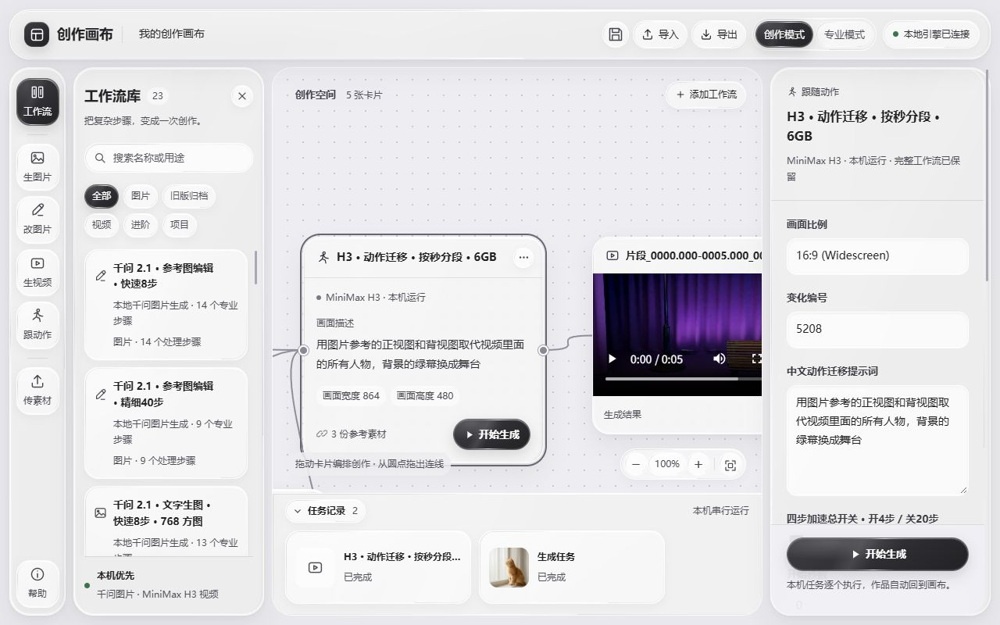
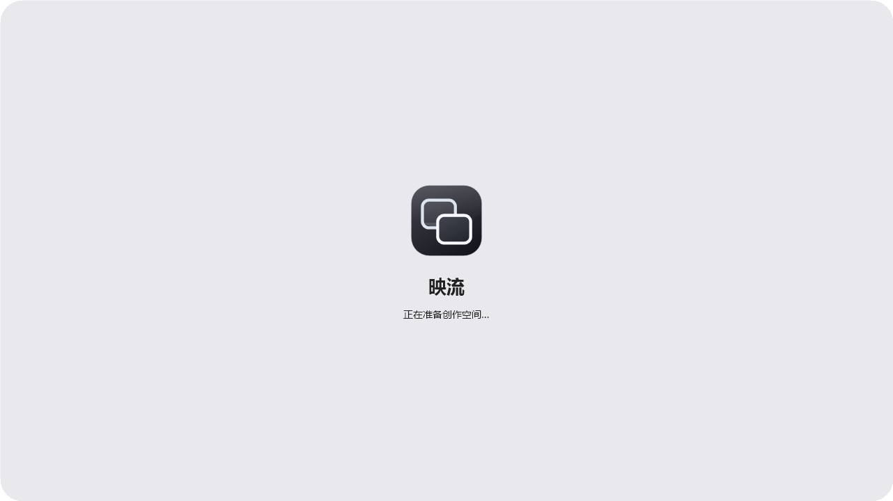
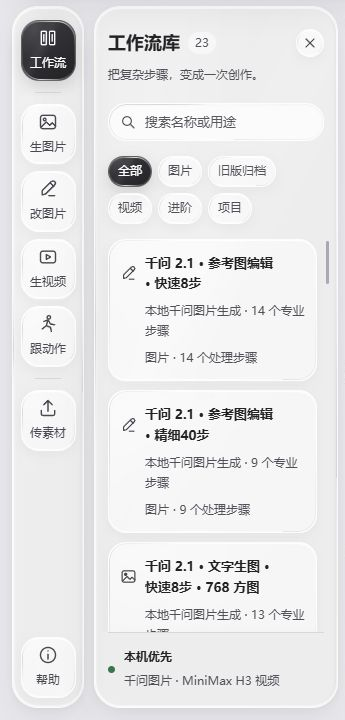
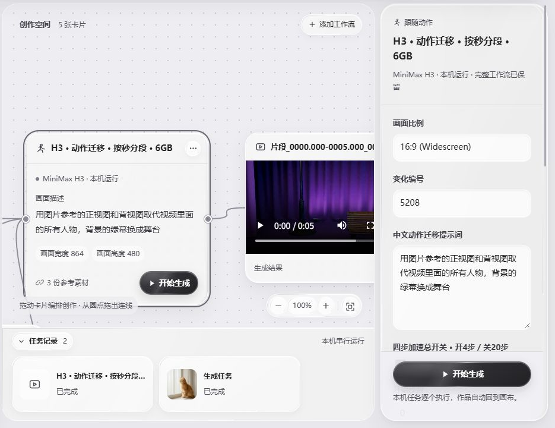
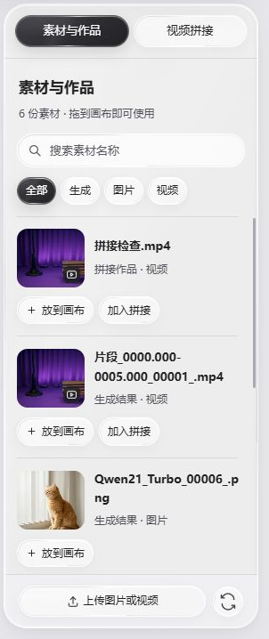
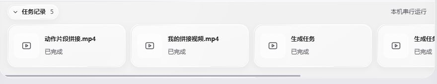
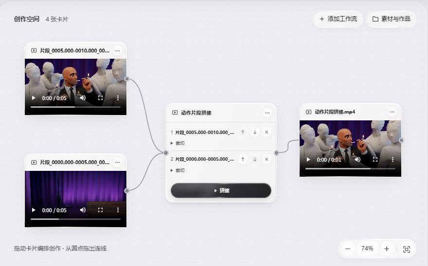
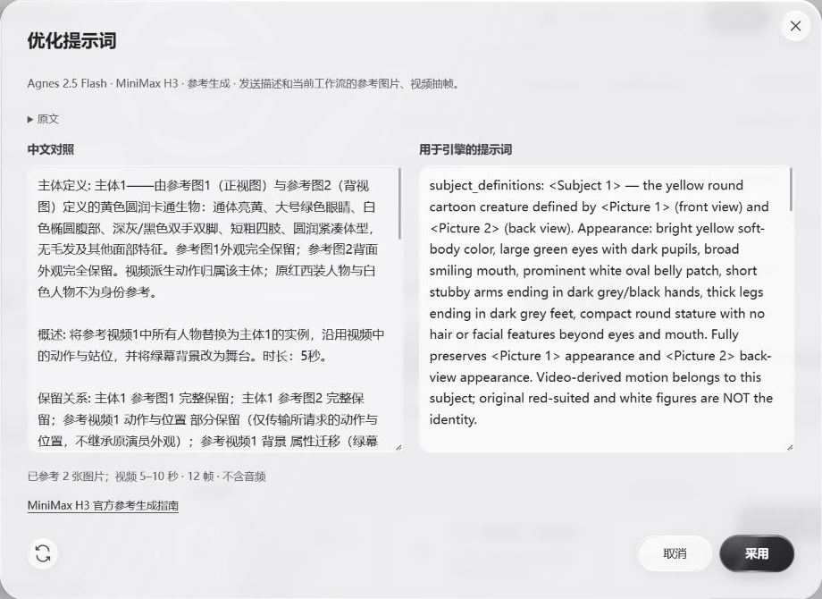

# 映流 YingLiu · ComfyUI 无限画布

把 ComfyUI 工作流放进中文无限画布，用卡片、素材和连线编排图片与视频创作。

支持多个独立画布、素材收纳、视频片段拼接、专业模式同步，以及可自行配置 AI API 的双语提示词优化。图片和视频生成仍由你自己的 ComfyUI 执行。

## 软件界面



*真实历史截图；名称、布局和部分按钮与当前版本可能不同。*



## 界面分区：每块区域做什么

以下为软件的**真实历史截图**，按功能截取相关区域。截图来自早期版本，具体布局和按钮以当前软件为准。

### 工作流库：导入、搜索和添加工作流



截图为早期版本；新版从左侧打开工作流库后，点击“导入工作流”选择 ComfyUI 导出的 JSON，也可以搜索或按分类查找已有工作流。点击列表项，即可把工作流卡片放进当前画布。导入工作流不会自动安装模型和节点。

### 动作迁移：连接参考、设置时间、接续片段



将人物参考图和动作视频拖入画布，分别连到动作工作流卡片；选中卡片后设置描述和起止时间。支持接续的 H3 工作流会显示“接续上一段”：在同一画布选择上一段作品，让它的末帧引导新片段开头。不同工作流显示的参数可能不同。

### 素材与作品：查找、收纳和复用



展开右侧面板，可搜索并按生成、图片或视频筛选。把素材或作品拖到画布即可复用；也可以将画布中的媒体拖回右侧收纳。选中工作流卡片后，右侧“详细设置”用于调整更多参数。

### 任务记录：查看进度和结果



截图为早期版本，任务记录当时位于底部；当前版本点击顶部的“任务”，查看等待、生成中、完成或失败的任务以及进度。点击记录可尝试跳转到对应画布和卡片；任务完成后，作品可以在画布和素材栏查找。

## 主要功能

### 1. 多张无限画布

每个项目可以使用独立画布：点击画布标签旁的 **+** 新建，点击标签切换；拖动标签调整顺序，右键标签或使用“画布管理”重命名、删除。工作流、图片、视频和生成结果都可以放在画布中。滚轮缩放，按住 Space 拖动画布；双击空白处可以创建节点。

### 2. 导入并运行 ComfyUI 工作流

把 ComfyUI 导出的普通 JSON 或 API JSON 导入工作流库，再添加到画布。将图片、视频素材拖进画布，从素材卡片的圆点连到工作流卡片，选中卡片即可修改常用参数并生成。完成后，作品出现在画布和“素材与作品”中；点击连线可以断开，原素材仍会保留。

工作流原始节点会保留。普通节点图可在专业模式中编辑并通过同步桥与画布同步；不认识的自定义节点也能保留，但其中文参数不一定自动显示。使用前仍需自行安装工作流所需的 ComfyUI、自定义节点和模型。

### 3. 动作视频分段与画面接续

对于支持的 MiniMax H3 动作工作流，连接人物参考和动作视频后，可以先生成 **0–5 秒**。接着在同一张工作流卡片上设置 **5–10 秒**，在卡片下方的 **“接续上一段”** 选择第一段作品，再生成下一段。软件会用上一段最后一帧引导下一段开头，人物参考和动作视频仍按原工作流使用。

接续是画面引导，不能保证两段逐帧完全一致；声音也不会自动续接。请检查成片接缝。不同工作流的节点结构与能力不同，未适配的工作流不会自动获得这一功能。

### 4. 视频片段拼接



*真实历史截图；界面布局可能与当前版本不同。*

双击画布空白处，创建“视频拼接”节点；将需要的视频片段连接进去，在节点内调整顺序和截取范围，再点击 **拼接**。完成后的新作品会回到画布。这个步骤需要本机安装 FFmpeg 和 ffprobe。

### 5. 自己配置 AI，优化提示词



*真实历史截图；当前版本的选项可能有所不同。*

在设置中填写服务地址、模型名和密钥，可使用 OpenAI 兼容接口、Anthropic Messages、Ollama 或 Agnes。选中工作流卡片后，通过提示词旁的优化按钮生成建议；先查看优化结果和中文对照，点击 **采用** 后才会替换原文。

如启用图片参考，当前卡片连接的图片和视频抽帧会发送给所选 AI 服务；纯文字模式不会发送图片。能否理解图片取决于服务和模型。密钥保存在本机，不放入画布导出文件。

## 开始使用

在 [Releases](https://github.com/che59064-spec/YingLiu-ComfyUI-Canvas/releases) 下载 Windows 便携包，或下载源码自行构建。便携包不包含模型、ComfyUI 或 Python；首次使用前请准备以下依赖。

需要 Python 3.10 或以上版本。画布后台只使用 Python 标准库，无需额外安装 Python 包。生成图片、视频需要自行安装并启动 [ComfyUI](https://github.com/Comfy-Org/ComfyUI)，以及工作流所需节点和模型；视频拼接、视频参考抽帧还需要 FFmpeg 和 ffprobe 在 PATH 中。

Windows 原生窗口需要 64 位 Windows 10/11、.NET Framework 4.8、[WebView2 Evergreen Runtime](https://developer.microsoft.com/microsoft-edge/webview2/)。在软件目录打开 PowerShell：

```powershell
powershell -ExecutionPolicy Bypass -File .\setup.ps1
```

脚本会寻找已安装的 Python、保存仅本机使用的配置，并从 Microsoft NuGet 下载校验过的 WebView2 SDK 后构建 `映流.exe`。它不安装模型，不启动生成任务。需要桌面快捷方式时加 `-CreateShortcut`。Python 未被自动找到时，使用 `-Python "你的 Python 完整路径"`。

已有 Windows 便携包可直接打开 `映流.exe`；仍需本机 Python、WebView2 Runtime 和已有 ComfyUI。若不能自动发现 Python，运行 `setup.ps1 -SkipBuild`，或将 `config.example.json` 复制为 `config.json`，填写 `app_python`。便携包不包含 Python 和模型权重。

也可在 Windows、Linux 或 macOS 使用浏览器界面：

```shell
python server.py --port 8766
```

随后访问 `http://127.0.0.1:8766`。原生圆角、开屏和窗口按钮仅适用于 Windows；浏览器版本保留画布功能。ComfyUI 仍需运行在同一台机器。服务固定监听本机地址，不提供互联网多用户部署。

## 管理多张画布

画布左上角的标签可以拖动排序；右键标签或点击旁边的“画布管理”可重命名和删除。标签放不下时，使用两侧箭头翻看。至少保留一张画布，有生成或拼接任务的画布需要等任务结束后才能删除；删除前会保存本机备份，素材和作品保留。

## 接入自己的工作流

使用界面中的工作流导入入口选择 ComfyUI JSON。完整专业图保留在卡片内，常用参数在中文画布中显示；未适配的自定义节点可在专业模式继续编辑。

1. 配置并连接本机 ComfyUI，安装工作流依赖的自定义节点和模型。
2. 导入工作流 JSON，将工作流卡片添加到画布。
3. 把图片或动作视频拖到画布，并连接到工作流；选中卡片后调整参数。
4. 点击生成。生成的作品会回到画布，也可以在素材栏中查找并复用。

软件无法代替安装节点、下载模型或补齐原电脑上的输入文件。导入后请检查兼容性提示；缺失项需要在你的 ComfyUI 环境中准备好，工作流才能执行。不会自动执行导入文件或生成任务。

普通节点图与 API 工作流都可保存。普通节点图执行需要专业模式及同步桥把图转换为可执行请求；未知节点没有经过确认的中文字段时，继续在专业模式编辑。超过 JavaScript 安全整数范围的种子等数值保持原样，简化面板会只读显示，避免浏览器转换造成精度丢失。

专业模式双向同步需要把 `bridge/ComfyUI-CreationCanvas` 复制到 ComfyUI 的 `custom_nodes` 中，然后在无任务运行时由你重新启动 ComfyUI。配置本机目录后，软件自动启动 ComfyUI 时也会安装该桥；已在线的 ComfyUI 不会被强行重启。

## 动作片段接续

选中当前画布的 H3 动作工作流卡片，在卡片下方的“接续上一段”选择当前画布中已生成的视频。生成时提取所选视频最后一帧，作为下一段开头的画面引导；人物参考和动作片段仍按原工作流使用。该设置可随时清除，画面与音频的接缝仍需实际检查。

## 设置自己的 AI

打开 AI 设置，填写服务地址、模型名和密钥。保存只写入本机；点击连接测试或优化时才调用服务。支持 OpenAI 兼容接口、Anthropic Messages、Ollama 本地模型与 Agnes。接口类型描述的是协议，模型名称由你按服务商说明填写。不同模型的结构化输出、图片理解能力不同；默认通用返回模式，如服务明确支持可选 JSON 或严格 JSON Schema。

提示词优化先展示结果和中文对照，点击采用后才替换原文。启用图片参考时，当前工作流连接的图片和视频抽帧会发给你选择的 AI 服务；不会上传整个素材库。纯文字模式不发送图片。API 密钥不进入画布导出和发布包。

OpenAI 兼容接口对明确的 o1/o3/o4 与 GPT-5/GPT-6 模型使用推理参数格式；自定义中转别名无法判断真实模型，需要服务端适配。推理令牌也计入输出上限，内容触顶时会保留原提示词，不自动增加额度或重复请求。连接测试可能只确认接口连通，界面会说明是否收到完整文字。

## 本机引擎配置

右上角连接设置可填写 ComfyUI 地址、目录、Python 环境及自动启动选项。只连接已运行的 ComfyUI 时无需填写其目录。自动启动需要填写包含 `main.py` 的目录及该 ComfyUI 环境的 Python 路径。

高级设置放在 `config.json`，页面保存的 `data/settings.json` 优先于该文件；环境变量 `YINGLIU_PYTHON`、`YINGLIU_COMFY_ROOT`、`YINGLIU_COMFY_PYTHON` 可覆盖对应 Python 或目录。相对路径基于映流目录。

`comfy_args` 是附加启动参数的字符串列表，默认不预设显存策略；`extra_model_paths` 为 ComfyUI 额外模型路径配置文件的列表。`input_dir`、`output_dir` 可指向已有目录。换电脑时请重新设置这些路径。

## 数据与备份

画布、上传素材、工作流、任务记录和凭据保存在本机 `data/`，请定期离线备份并限制该目录访问。导入映流画布会新建独立画布，原画布继续保留。画布 JSON 导出不包含素材文件、模型和用户在“AI 设置”填写的 API 配置，换电脑仍需迁移素材并准备生成环境。原工作流中自行填写的 API 节点密钥仍属于工作流原图；软件只遮蔽其友好控件，不会擅自删除，分享前请自行清除。关闭窗口不会停止 ComfyUI 已在运行的任务。

## 开发与发布

```shell
python -m unittest discover -s tests
python scripts/package_release.py
python scripts/package_release.py --portable
```

部分媒体测试需要 FFmpeg；桥接插件的缓存测试需要 ComfyUI 环境中的 PyTorch。源码包使用文件白名单，排除 `data/`、个人 `config.json`、日志、模型、素材、旧安装包和个人测试截图；便携包仅额外加入本次构建的主程序及有官方来源的 WebView2 组件。

映流自身源码采用 [MIT 许可证](LICENSE)。相关依赖及模型使用各自的许可证，详见 [第三方说明](THIRD_PARTY_NOTICES.md) 和 [发布说明](docs/发布说明.md)。
